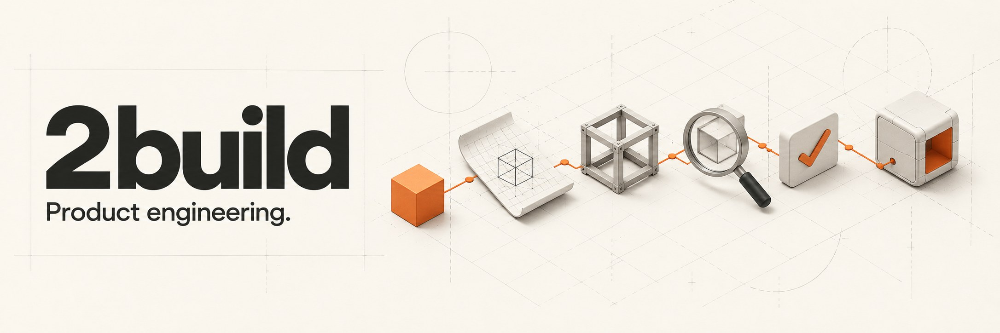
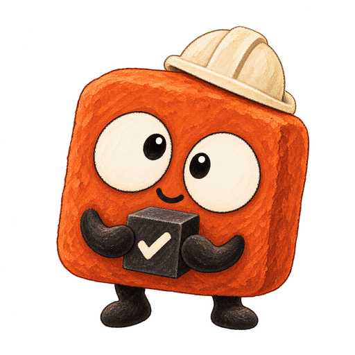

# 2build

[English](README.md) | [Tiếng Việt](README.vi.md) | [中文](README.zh.md) | [日本語](README.ja.md) | 한국어





**프로토타입을 확인하세요. 나머지는 Autopilot에 맡기세요.**

**[Autopilot으로 시작](#설치) · [문서 읽기(영어)](docs/install.md)**

2build는 coding agent가 기능 하나를 완성하도록 돕습니다. 요구사항을 전달하고 화면 프로토타입을 확인한 뒤, **Autopilot**에 코드 작성, 검증, 수정을 맡기세요.

작은 화면 작업은 **약 5분** 안에 프로토타입을 보는 것을 목표로 합니다. 실제 시간은 작업, 모델, 프로젝트에 따라 달라집니다.

- **품질:** 전달 전에 코드를 리뷰하고 테스트하며 문제를 수정합니다.
- **생산성:** Agent가 각 단계를 진행하므로 계속 지시할 필요가 없습니다.
- **효율:** 프로토타입을 먼저 조정해 다시 만드는 일을 줄입니다.

**Claude Code, Codex, Antigravity, OMP, Grok** 및 Claude Code skills를 지원하는 모든 coding agent에서 사용할 수 있습니다.

2found의 제품입니다. 이전 이름은 babysit이며 `bbs` CLI, `bbs:` skill, `.babysit` 상태는 호환성을 유지합니다. [브랜드와 이름](BRANDING.md)(영어)을 참고하세요.

<a id="설치"></a>

## 하나의 prompt로 설치

터미널을 실행할 수 있는 coding agent에 다음을 붙여 넣으세요:

```text
지금 사용 중인 coding agent에 2build을 설치해 주세요.
https://raw.githubusercontent.com/2found/2build/main/docs/install.md 를 따르세요.
OS와 현재 agent를 확인하고, 작동하는 bbs가 있으면 재사용하거나 CLI를 설치한 뒤 이 agent에만 skill pack을 설치하세요.
bbs --version과 설치된 skills를 검증하고, 필요한 조건이 빠졌다면 성공이라고 하지 말고 알려 주세요.
재시작이 필요한지 설명하고, 첫 작은 작업을 실행할 수 있도록 이 agent에 맞는 정확한 Autopilot 호출을 알려 주세요.
```

지원되는 coding agent와 기존 model 이용 권한이 필요합니다. Claude Code와 Codex는 CLI가 PATH에 있어야 합니다. 2build용 별도 model 계정은 필요 없으며 agent의 일반 이용 요금은 적용됩니다. **Orca는 Foreman에만 필요합니다.** [설치 및 문제 해결](docs/install.md)(영어)을 참고하세요.

<details>
<summary>직접 명령을 실행하려면: macOS / Linux의 Homebrew</summary>

```bash
brew tap 2found/2build https://github.com/2found/2build
brew install 2found/2build/bbs
bbs install
```

`bbs install`은 Claude Code, Codex, Antigravity, OMP를 자동 감지합니다. Grok 및 다른 호환 agent는 [skill 설치 안내](docs/install.md#grok-and-other-compatible-agents)를 참고하세요. 하나만 선택하려면 `bbs install claude`, `bbs install codex`, `bbs install antigravity`, `bbs install omp`를 사용하세요. 설치 후 agent를 재시작하세요. Homebrew가 없으면 [release archive](docs/install.md#release-archives-macos-or-linux)를, Windows에서는 WSL을 사용하세요.

</details>

## 새 프로젝트 시작

[**2build starters**](https://github.com/2found/2build-starters)는 agent 작업 환경,
아키텍처 가이드, 테스트와 로컬 QA를 포함하는 버전 관리 프로젝트 템플릿입니다.
첫 템플릿은 `hono-bun`으로, TypeScript와 Zod를 사용하는 Bun/Hono API입니다.

`bbs bootstrap`과 `bbs starter check`는 CLI 1.95.0 이상에서 사용할 수 있습니다. Starter
안정 릴리스를 GitHub에서 직접 다운로드할 수 있습니다. 명령어와 요구 사항은
[빠른 시작 안내](docs/starters.md)를 참고하세요.

<a id="autopilot-하나의-ticket"></a>

## 첫 ticket 실행

1. Agent를 재시작하고 Git repo를 열어 성공 조건이 명확한 작은 bug나 기능을 고르세요. Autopilot은 현재 checkout에서 작업하고 변경 사항을 commit하지 않은 채로 남겨 둡니다. 작업을 분리하려면 먼저 원하는 branch를 만드세요.
2. **Agent chat에서 skill을 호출**하고 예제를 자신의 작업으로 바꾸세요:

   | Agent | 예제 |
   |-------|------|
   | Claude Code | `/bbs:autopilot "저장된 검색 화면을 추가해 주세요. 프로토타입을 먼저 보여 준 뒤 구현, 리뷰, QA를 진행하세요."` |
   | Codex | `$bbs:autopilot "저장된 검색 화면을 추가해 주세요. 프로토타입을 먼저 보여 준 뒤 구현, 리뷰, QA를 진행하세요."` |
   | OMP | `/autopilot "저장된 검색 화면을 추가해 주세요. 프로토타입을 먼저 보여 준 뒤 구현, 리뷰, QA를 진행하세요."` |
   | Grok | `/bbs:autopilot "저장된 검색 화면을 추가해 주세요. 프로토타입을 먼저 보여 준 뒤 구현, 리뷰, QA를 진행하세요."` |
   | Antigravity / 다른 호환 agent | 설치된 `autopilot` skill로 작업하도록 요청하세요. |

3. 계획을 검토하고 UI 작업은 프로토타입을 여세요. 여기서 배치, 상호작용, 범위를 조정합니다. Autopilot이 `/goal` block을 반환하면 같은 agent에 붙여 넣어 실행을 시작하세요. Goal mode가 없는 agent에서는 첫 요청에 `--stop-after=plan`을 추가해 이 검토 단계에서 멈추게 한 뒤 handoff의 재개 지시를 따르세요. 무인으로 실행하려면 `--auto`를 추가하세요(예: `/bbs:autopilot --auto "…"`). Autopilot이 스스로 계획을 검토하고 `/goal` block을 출력하지 않으며, agent가 허용하면 직접 goal을 설정하고, 그렇지 않으면 ticket이 완료되거나 막힐 때까지 같은 session에서 계속 작업합니다.
4. Autopilot이 구현, 리뷰, 수정, 테스트, QA를 수행하게 두세요. 완료 gate를 통과하면 검증된 변경을 commit하지 않은 채 checkout에 남기고 근거를 함께 제공합니다(직접 commit하거나 `create-pr`에 넘기세요). 진행이 막히면 부족한 입력을 명시합니다. 재시작 후 handoff의 ticket ID로 재개할 수 있습니다.

첫 ticket에는 Orca, 새 worker session, 프로젝트 설정이 필요 없습니다. 시작 전에 session model을 선택하세요. [진행 확인과 session 복구](docs/companion-cli.md).

## 2found와 다음 단계로

제품에 더 필요한 것이 생기면 다음 작업에 맞는 도구를 선택하세요:

| 다음 단계 | 살펴보기 |
|-----------|----------|
| 제품에 AI agent 추가 | [**Soot**](https://trysoot.com), powered by **2agent** — **agent as config** — 소스 코드에 설정을 더하세요. AI 동료가 늘어납니다. |
| 만든 제품 배포 | [**2server**](https://github.com/2found/2server) — 직접 소유한 인프라에서 앱을 배포하고 운영하세요. |
| 고객이 제품을 발견하게 하기 | [**2market**](https://2found.dev/#2market) — 제품 맥락, 콘텐츠, 채널을 하나의 흐름으로 연결하는 개발 중인 마케팅 작업 공간. |

제품 개발은 2build로 시작하고, 필요할 때 이 제품들을 살펴보세요.

## 작업 내용으로 선택

`/bbs:autopilot`은 하나의 ticket(기능 또는 bug 수정)을 plan, review, QA까지 진행합니다. `/bbs:foreman`은 여러 ticket으로 이루어진 프로젝트를 실행합니다. 특정 작업에는 skill을 직접 호출하세요.

개별 skill과 workflow 예제는 [skill 목록](docs/skills.md)을 참고하세요.

<a id="foreman-설정"></a>
<a id="foreman-여러-ticket으로-구성된-프로젝트"></a>

## 더 큰 프로젝트: Foreman

여러 ticket에 의존성이 있다면 [Foreman](docs/foreman.md)을 사용하세요. [Orca](https://www.onorca.dev)로 전체 계획을 세우고, 자식 ticket을 worktree로 분리하고, 준비된 작업을 dispatch하며 프로젝트 전체 QA를 수행합니다. 기본적으로 프로덕션 작업을 dispatch하기 전에 부모 계획과 설계를 검토합니다. 명시적인 `--auto`는 해당 검토를 worker에 위임합니다. worker는 커밋하지 않으며, 각 phase는 phase QA 후 하나의 커밋으로 반영됩니다.

<details>
<summary>CLI 및 설정 세부 정보</summary>

## Skill과 CLI

Skill은 agent용 workflow이고 `bbs`는 이를 지원하는 CLI입니다. `/bbs:foreman`은 프로젝트 조정자를 실행하며, `bbs foreman`은 model 정책 조회, 영구 Foreman 기록, phase(`seal`, `integrate`, `land`, `release`), 다음 단계 제안, 보고서를 관리하고, `bbs contract`는 병렬 ticket이 의존하는 인터페이스 계약을 관리합니다. `/bbs:autopilot`은 단일 ticket workflow를 실행하며, `bbs autopilot`은 checkpoint와 상태 관리 도구를 제공합니다. `bbs ticket`은 ticket 식별, DAG 관계, 증거, 테스트 환경 lease, seal된 작업 가져오기를 관리합니다.

자주 쓰는 CLI 명령:

```bash
bbs dashboard
bbs foreman report <parent-ticket>
bbs foreman next <parent-ticket>
bbs ticket dag <parent-ticket>
bbs autopilot snapshot --json
bbs autopilot recover --json
```

`snapshot`은 ticket의 기준 상태와 gate 증거를 읽습니다. `recover`는 작업을 재개할 수 있도록 분량이 제한된 산출물 발췌를 추가합니다.

사용법은 `bbs <subcommand> --help`로 확인하세요. 자세한 내용은 [지원 CLI](docs/companion-cli.md), [git flow](.claude/skills/references/git-flow.md), [운영](docs/operations.md)을 참고하세요.

## 시맨틱 결정

`semantic-decision`은 작업 규모, 복잡도, 라우팅, 테스트 영향, 리뷰 판단을 명시적이고 재사용 가능한 skill 단계로 만듭니다. 기본 provider는 현재 LLM이며 별도 설정이나 추가 model 프로세스가 필요 없습니다. Cloudflare를 사용하려면:

```bash
bbs config set semantic_decision_provider cloudflare
bbs config set semantic_decision_model clef-flash  # or clef
```

`CLOUDFLARE_ACCOUNT_ID`와 `CLOUDFLARE_API_TOKEN`을 환경 변수 또는 `~/.babysit/.env`에 설정하세요. provider는 사용자 설정만 선택할 수 있고, 프로젝트 정책은 외부 추론을 제한할 수 있습니다. Cloudflare 오류나 불확실한 답변은 현재 LLM으로 대체됩니다. [skill](.claude/skills/semantic-decision/SKILL.md)과 [계약](.claude/skills/references/semantic-decision.md)을 참고하세요. 설정 경로, 기본값, 프로젝트 제한, 사람 검토 동작은 [dashboard 컨트롤이 없는 설정](docs/operations.md#settings-without-a-dashboard-control)을 참고하세요.

</details>

## 문서(영어)

[설치 및 문제 해결](docs/install.md) · [Skill 선택](docs/skills.md) · [진행 확인](docs/companion-cli.md) · [프로젝트 조정](docs/foreman.md)

Coding agent는 [llms.txt](llms.txt)에서 Markdown 안내와 runtime 규약을 바로 참조할 수 있습니다.

## 저장소 구조

- `bbs` — 여러 명령을 처리하는 바이너리입니다. Build 결과는 gitignore 대상이며, `go build -o bbs ./cmd/bbs`로 만듭니다. Hook은 컴파일된 하위 명령인 `bbs hooks <name>`입니다.
- `.claude/skills/` — agent skill과 workflow 참고 자료.
- `internal/` — Go CLI와 서비스.
- `web/` — dashboard SPA. 릴리스 build에 포함됩니다.
- `tests/`, `docs/` — 검증 모음과 사용자 문서.

## 텔레메트리

Skill 사용 기록은 로컬 `~/.babysit/analytics/` 아래에 JSONL 형식으로 저장됩니다. 텔레메트리는 무인 실행의 주요 피드백 채널입니다.

## 라이선스

MIT.
