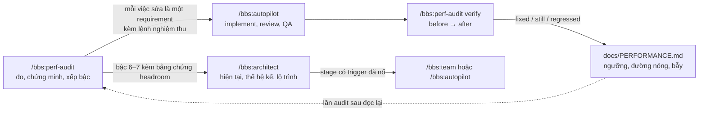

# perf-audit và architect: đừng mua máy to hơn khi chưa biết CPU đi đâu

## Câu chuyện ai cũng từng nghe

App chậm. Có người bảo "nâng server đi". Có người bảo "thêm Redis". Người
khác nữa đề xuất "tách microservice cho dễ scale". Ba tuần sau hoá đơn cloud
gấp đôi, còn app vẫn chậm y như cũ, vì thủ phạm là một vòng lặp gọi DB mười
nghìn lần và nó chạy trên máy to hơn cũng vẫn là mười nghìn lần.

Chuyện này lặp lại nhiều đến mức thành luật bất thành văn: **phần lớn "cần
server to hơn" là lãng phí nằm trong code hoặc query**. Chỉ khi đã đo, đã
quy được chi phí cho đúng việc thật, thì tiền mua thêm máy mới đáng tiêu.

2build vốn lo vòng `plan → implement → review → test → QA → release`. Vòng đó
trả lời "làm đúng chưa". Nó chưa trả lời "hệ thống có chịu nổi không" và "nên
lớn lên theo hướng nào". Hai skill mới lấp đúng chỗ đó:

| Skill | Câu hỏi nó trả lời | Nó viết ra |
|---|---|---|
| `perf-audit` | Người dùng đang thấy chậm ở đâu, vì sao, sửa gì trước? | báo cáo đo đạc + hồ sơ hiệu năng `docs/PERFORMANCE.md` |
| `architect` | Hệ thống bây giờ thật ra trông thế nào, và thế hệ kế tiếp nên là gì? | sơ đồ kiến trúc hiện tại + `docs/architecture-next.md` với lộ trình |

Cả hai **không sửa code, không đụng hạ tầng, không ghi dữ liệu**. Chúng đo,
chứng minh, đề xuất. Việc sửa đi qua `autopilot` như mọi thay đổi khác, mang
theo đúng con số của audit làm tiêu chí nghiệm thu.

## Viết cho người cầm tiền, không cho người đọc stack trace

Người quyết chuyện hiệu năng thường là owner: người phải chọn giữa "thêm 40
USD mỗi tháng" và "để kỹ sư sửa hai ngày". Họ không cần flame graph. Họ cần
biết khách đang cảm thấy gì và mỗi lựa chọn tốn bao nhiêu.

Nên `perf-audit` có vài luật viết cứng:

- Con số nào cũng kèm ngày và nguồn, đọc theo cảm nhận người dùng: "mở một
  chương mất 0,15 s, mục tiêu 0,3 s", không phải "p95 145 ms trên route X".
- Thuật ngữ của nhà cung cấp được giải thích một lần ("Cloudflare, lớp CDN
  đứng trước website").
- Đề xuất nào cũng ghi **tiền mỗi tháng, thời gian gián đoạn, rủi ro, có đảo
  ngược được không, và ai phải duyệt**.
- Phần kỹ thuật nằm dưới phần tóm tắt cho owner, để kỹ sư vẫn có đủ bằng
  chứng mà owner không phải lội qua.

Và nó **không dừng lại để hỏi**. Journey nào kiếm ra tiền, ngưỡng nào chấp
nhận được, downtime bao lâu thì ổn: skill tự suy từ tài liệu sản phẩm, code và
analytics, ghi thành `assumed (<nguồn>, <ngày>)`, rồi gom vào mục "Cần bạn
quyết" kèm hậu quả nếu đoán sai. Đây là luật chung của 2build: chạy được khi
không ai ngồi trước bàn phím, và chỉ hỏi khi đoán sai sẽ ra code sai. Với
`perf-audit`, câu hỏi duy nhất được phép là xin quyền đọc production khi chưa
có.

## Production chỉ để đọc

Đo trên production là con dao hai lưỡi: số thật nhất nằm ở đó, nhưng một lệnh
sai cũng nằm ở đó. Nên luật an toàn được viết thẳng vào skill:

- Chỉ dùng đường truy cập mà tài liệu repo hoặc owner gọi tên là chỉ-đọc.
- Không restart, không redeploy, không purge cache, không bắn load test vào
  production để "đo cho chắc".
- Câu `EXPLAIN` chạy trong `BEGIN READ ONLY … ROLLBACK`.
- Log được gom theo route, **không bao giờ trích nguyên dòng**: không id,
  email, IP hay tham số SQL nào lọt vào báo cáo. Script `log_paths.py` đi kèm
  skill tự thay email bằng `:email`, chuỗi dài giống token bằng `:token`, id
  bằng `:id`.
- `pg_snapshot.sql` chỉ đọc thống kê, tự dò xem `pg_stat_statements` có bật
  không, và lọc bỏ câu SQL nào chứa password, secret, token hay api key.

## Bậc thang: sửa ở bậc thấp nhất gỡ được nguyên nhân

Mỗi nguyên nhân đã chứng minh được xếp lên một bậc thang. Bậc càng thấp càng
rẻ, ảnh hưởng càng hẹp, càng dễ hoàn tác:

| bậc | gỡ cái gì | hoàn tác |
|---|---|---|
| 1 Code | việc thừa trong mỗi request: N+1, await tuần tự, poll và retry loop | revert |
| 2 Query & index | việc thừa trong mỗi câu SQL | drop index |
| 3 Dữ liệu | việc sinh ra do dữ liệu phình: retention, bloat, bộ đếm thay `COUNT(*)` | **không đảo ngược** nếu không có backup |
| 4 Luồng | việc tính năng đòi hỏi: đẩy ra job nền, gom lô, tính trước | cần plan |
| 5 Cache trên thứ đã có | việc lặp y hệt nhau | tắt đi |
| 6–7 Hạ tầng, kiến trúc | việc thật vượt quá một tài nguyên | `architect` thiết kế |

Ba điều cấm: cache thứ mà một index đã sửa được, thêm máy cho chi phí chưa
quy được về đâu, và tách service chỉ vì hiệu năng. Nguyên nhân chưa chứng minh
được ghi là **nghi vấn**, không bao giờ được xếp hạng thành việc cần sửa.

## architect: sẵn sàng lớn lên nghĩa là có đường nối, chưa phải có linh kiện

`architect` làm hai việc tách bạch. **Hiện tại**: vẽ lại kiến trúc đang chạy,
đúng với code, config và production, không có gì phỏng đoán. Tài liệu và code
cãi nhau thì code thắng, và chỗ lệch thành một phát hiện. **Thế hệ kế tiếp**:
chọn một chân trời (từ PRD, roadmap, ticket, hoặc mặc định ×2 và ×5 tải đỉnh
hiện tại), chiếu bảng headroom lên đó, xem thứ gì vỡ trước, rồi thiết kế bộ
thay đổi nhỏ nhất vượt qua được.

Nguyên tắc mà mình thích nhất: **giữ đường nối (seam) bây giờ, thêm linh kiện
khi trigger của nó nổ**. "Database đọc URL từ env" là một seam: nó gần như
miễn phí, và ngày cần tách DB riêng chỉ còn là đổi một biến. Còn bản thân cái
DB riêng thì chờ đến khi có số đo đòi nó.

Mỗi bước trong lộ trình phải có trigger viết theo một khuôn đo được:

```text
<tín hiệu> <phép so> <ngưỡng> trong <n> trên <m> cửa sổ
CPU PSI some avg60 > 20 % trong 2 trên 3 cửa sổ đỉnh hằng tuần
```

Tín hiệu nào chưa được thu thập thì trigger đó chưa thể nổ. Skill ghi nó vào
hồ sơ hiệu năng dưới dạng `TODO(2build):` để lần sau có cái mà đo. Mỗi bước
kèm điều kiện tiên quyết, chi phí, cách rollback và cách kiểm chứng. Cuối tài
liệu luôn có mục "Chưa làm" để Redis, read replica hay microservice có chỗ đứng
rõ ràng: chưa, vì sao chưa, và trigger nào sẽ đổi ý.

## Thử thật trên 2novel

Viết skill xong, tụi mình cho chạy ngay trên
[2novel](https://2novel.app), app dịch truyện cũng của 2found: một tiến trình
API Bun gộp cả HTTP lẫn worker, một web Next.js, chạy chung một VM 2 nhân và
một cụm Postgres với các sản phẩm khác. Owner cho phép đọc DB một lần, trong
transaction chỉ-đọc.

**Thứ khách dùng hằng ngày thì nhanh.** Mở sách p95 105 ms, mở chương 145 ms,
đều dưới ngưỡng 300 ms.

**Nhưng log kể một chuyện chưa ai báo.** Trong bốn phút buổi chiều hôm đó,
mọi màn hình đều treo: trang thư viện mất tới 37 s, nút huỷ tới 69 s, và cả
`/readyz`, endpoint chỉ chạy `SELECT 1`, cũng mất 23,7 s. Lần theo thì ra một
thao tác huỷ hàng loạt: huỷ một sách đang chờ dịch thì hoàn tiền **từng job
một, tất cả cùng lúc**, bằng một `Promise.all` không giới hạn. Hôm đó là
39.523 job, mỗi job một transaction, cùng đổ vào pool 10 kết nối đang phục vụ
request của mọi khách. Nút huỷ chậm nên người dùng bấm lại, tổng cộng 25 lần,
mỗi lần lại thêm một đợt hoàn tiền song song.

Lỗi trong log là `keepalive_timeout`, kèm gợi ý vận hành "restart
translate-api". Restart sẽ không sửa được gì, vì socket không chết, pool đang
bận. Báo cáo ghi điều này thành một bẫy đã biết trong hồ sơ hiệu năng để lần
sau không ai restart nhầm.

**Thứ skill khuyên không làm cũng quan trọng không kém.** Phản xạ tự nhiên
sau một sự cố như vậy là "tách worker ra máy riêng" hoặc "nâng máy". Báo cáo
đặt chúng vào mục "Không đáng làm lúc này", với số liệu: API 2novel dùng
khoảng 1 % một nhân CPU, Postgres mới dùng 53/100 kết nối. Nghẽn hôm đó là
lãng phí trong code, sửa ở bậc 1, chi phí 0 đồng.

Máy chủ dùng chung thì đúng là thiếu CPU thật (PSI trung bình 26,8 %, ngưỡng
20 %), nhưng 2novel chỉ chiếm khoảng 2 % tải. Dời 2novel sang máy khác gần như
không giúp được gì. Quyết định đúng nằm ở tầng nền tảng, và `architect` đưa
nó vào mục "Bạn cần quyết" với mặc định, thiệt hại nếu mặc định sai và hạn
chót.

Từ một lần audit, owner nhận được:

- **Ba việc sửa sẵn sàng giao cho `autopilot`**, mỗi việc kèm lệnh nghiệm
  thu: hoàn tiền theo lô nhỏ ở luồng nền để nút huỷ trả lời ngay (F1); log đủ
  route, workspace và mã lỗi SQL thay vì tham số (F2); trang thư viện đọc bộ
  đếm thay vì cộng lại mọi chương ở mỗi lần poll (F3, chỉ làm khi F2 cho thấy
  khách bị chậm).
- **Một phát hiện `critical` từ `architect`**: không có cảnh báo nào cho lỗi
  5xx hay độ trễ của API, nên bốn phút treo kia có thể đã không báo cho ai.
- **Một lộ trình có trigger**: DB riêng chờ cụm Postgres vượt 80 % kết nối,
  tách worker chờ tỉ lệ CPU của worker vượt 30 %, chạy hai bản API chờ CPU
  vượt 70 % hoặc một cam kết downtime dưới 1 giờ/tháng. Hôm nay chưa bước nào
  nổ, nên chưa tốn đồng nào.
- **Những quyết định chỉ owner được đưa ra**, như xoá 2,5 GB dữ liệu cũ (không
  đảo ngược được) hay restart Postgres chung để bật thống kê câu SQL (khoảng 1
  phút gián đoạn cho mọi app trên VM).

## Sau khi sửa

`autopilot` làm F1 và F2 trong một lượt. Bản sửa lên production lúc 17:05
cùng ngày (giờ VN). Khoảng hai giờ sau, tụi mình chạy `/bbs:perf-audit verify`
trên chính báo cáo đó, với cùng nguồn log, cùng script và cùng cách bỏ phút sự
cố khi tính p95.

Kết quả là `fixed=1 still=2 regressed=0`. Chuyện không đơn giản như con số
đó.

| | trước | sau |
|---|---|---|
| Cả API treo khi có lần huỷ lớn | ~4 phút | ~15 s |
| `/readyz` (`SELECT 1`) chậm nhất | 23,7 s | 0,56 s |
| Nút huỷ chậm nhất | 69 s | 23 s |
| Nút huỷ báo lỗi | 2/25 lần | **3/5 lần** |
| Log có route, workspace, mã lỗi SQL | không | có |
| Thư viện của khách thật | không tách được | ~0,02 s (mới có 2 lượt) |

**F2 `fixed`.** Cả ba lệnh nghiệm thu đều đạt. `log_paths.py` tự in route
template mà không cần danh sách route viết tay, không còn dòng log nào chứa
tham số SQL, và lỗi DB có mã SQLSTATE. Log mới trả lời được ngay câu hỏi mà
báo cáo gốc phải để ngỏ: trang thư viện chỉ chậm với workspace nội bộ (p95
0,89 s), còn khách thật mở trong khoảng 20 ms. Mẫu còn nhỏ, nhưng nó khớp với
điều kiện mà báo cáo đặt cho F3 ("chỉ làm khi F2 cho thấy khách bị chậm").
Nên F3 vẫn `still`, và tụi mình cố ý để nó như vậy: chưa cần dựng bảng bộ đếm
và trigger trên một bảng 1,5 GB.

**F1 `still`, dù đã sửa đúng chỗ.** Cái `Promise.all` đã được thay bằng hoàn
tiền theo lô ở luồng nền. Ở lab, 5/5 test DB đều qua: số transaction chạy
cùng lúc không vượt giới hạn, mỗi job chỉ được hoàn một lần. Lần huỷ lớn đầu
tiên sau khi deploy chỉ làm app chậm khoảng 15 giây, thay vì 4 phút. Nhưng
nghiệm thu live đòi "không có `keepalive_timeout`, không route nào vượt 2 s",
và lần này vẫn có cả hai. Thêm vào đó, 3 trên 5 lần bấm huỷ báo lỗi.

Lần này thì log nói được vì sao, nhờ chính F2. Cả ba lỗi đều là `40P01`, tức
deadlock. Log Postgres có đủ 5 deadlock trong phút đó, và cả 5 đều là đúng một
cặp câu lệnh, cùng do lệnh huỷ sinh ra. Lệnh huỷ bắn một câu UPDATE lên pool
worker để nhả quyền giữ các job đang chờ, không chờ nó xong. Ngay sau đó, nó
chạy câu UPDATE thứ hai trên pool request để chuyển chính các job đó sang
trạng thái đã huỷ. Hai câu đi qua cùng mấy nghìn dòng theo hai thứ tự khác
nhau, nên Postgres phải giết một bên. Người dùng thấy lỗi thì bấm lại, và các
lần bấm lại góp phần tạo ra 15 giây chậm kia.

Trước khi sửa, lỗi này bị che hai lớp: sau bốn phút nghẽn pool, và sau dòng
`Failed query` không có mã lỗi. Nó thành F4, cũng ở bậc 1, chi phí 0 đồng,
không cần migration, kèm nghiệm thu "0 deadlock khi huỷ 10 lần liên tiếp 5.000
job".

Verify còn bắt được hai chuyện nhỏ hơn:

- **Gợi ý "restart translate-api" vẫn hiện ra** khi pool đang bận 9/10 kết
  nối, vì code chỉ coi pool là bận ở mức 10/10. Probe xong sau 14 giây, tức
  nó đã phải xếp hàng chứ socket không chết. Đây là F5, sửa vài dòng.
- **Một lần chậm 10 giây lúc 18:41 không dính tới lần huỷ nào.** Đúng lúc đó
  CPU của máy chủ dùng chung nghẽn 80 %. Báo cáo ghi nó là nghi vấn thuộc
  tầng nền tảng, không xếp thành việc sửa cho 2novel.

Còn hai chỗ chưa chắc, và báo cáo ghi thẳng ra. Thứ nhất, mới có một cửa sổ
đo khoảng hai giờ, trong khi luật nhiễu của skill đòi hai cửa sổ có lượng
truy cập tương đương. Thứ hai, tiền hoàn trên production chưa được đối soát,
vì việc đó cần đọc DB, mà quyền đọc DB phải được owner duyệt lại cho từng
lần.

Điều tụi mình rút ra là verify đáng chạy thật. Nếu dừng ở "test xanh, deploy
xong", F1 đã được đánh dấu là xong. Đo lại cho thấy bản sửa đúng hướng (4 phút
xuống 15 giây), thấy nó chưa đủ, và tìm ra nguyên nhân kế tiếp. Nguyên nhân đó
chỉ lộ ra vì việc sửa log (F2) đã được làm cùng lượt.

## Vòng khép kín



Hồ sơ hiệu năng là thứ nối các lần chạy với nhau. Nó giữ ngưỡng của từng
đường, nguồn tín hiệu và lệnh đọc chỉ-đọc, các bẫy đã biết, và sổ phát hiện.
Lần audit sau bắt đầu từ đó thay vì từ số 0, và mọi agent đọc `AGENTS.md` đều
được trỏ tới nó trước khi đụng vào hiệu năng.

## Dùng thử

```bash
brew tap 2found/2build https://github.com/2found/2build
brew install 2found/2build/bbs
bbs install
```

Rồi trong Claude Code hoặc Codex:

```text
/bbs:perf-audit                     # cả hệ thống
/bbs:perf-audit audit <trang/route> # một journey
/bbs:architect                      # vẽ hiện tại + thiết kế thế hệ kế
```

Không có quyền đọc production cũng chạy được: skill làm phần đọc code và đo
trong lab, rồi trả về một **kế hoạch đo**, liệt kê cho từng đường nóng tín
hiệu cần đọc, quyền cần có và mất bao lâu. Sức khoẻ khi đó là `not-measured`,
và skill nói thẳng như vậy thay vì đoán.

Lần tới có ai bảo "nâng server đi", hãy chạy `perf-audit` trước. Có khi câu
trả lời là một `Promise.all`.

Hướng dẫn đầy đủ (tiếng Anh): [Performance and architecture](../docs/performance-and-architecture.md).
Bản viết cho người không phải kỹ sư nằm trên [blog 2found.dev](https://2found.dev/vi/blog/); tài liệu 2build đọc tại [2found.dev/docs/2build](https://2found.dev/vi/docs/2build/).
